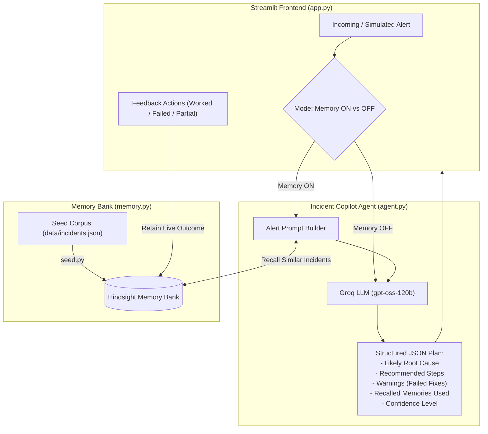

# 🚨 Incident Memory Agent

> **An AI-powered On-Call Incident Copilot that remembers what worked, warns against what failed, and continuously learns from engineer feedback.**

[](https://www.python.org/downloads/)
[](https://streamlit.io/)
[](https://groq.com/)
[](https://hindsight.vectorize.io)
[](https://opensource.org/licenses/MIT)

Development was coordinated with Band AI desktop ([band.ai](https://band.ai)).

---

## 📖 Overview

During high-severity production incidents, on-call engineers are under immense pressure to triage and resolve outages quickly. Traditional approaches suffer from two major flaws:

1. **Tribal Knowledge Loss:** Past incident postmortems are buried across Jira tickets, Google Docs, or Slack threads. Engineers often repeat mistakes by applying fixes that previously failed.
2. **Generic LLM Hallucinations:** Standard LLMs lack organizational context and provide generic, textbook troubleshooting advice that does not account for your specific service architecture or past incident history.

**Incident Memory Agent** solves this by pairing **Groq's** high-speed inference with **Hindsight's** semantic memory layer. The agent recalls past incident resolutions, warns engineers if a proposed fix has failed before, provides actionable step-by-step remediation plans, and learns in real time from post-fix feedback.

---

## ✨ Key Features

- **🧠 Semantic Incident Memory (Hindsight):** Retains historical incidents (alerts, logs, root causes, remediation steps, and resolution outcomes) in a persistent memory bank.
- **⚡ Blazing-Fast LLM Inference (Groq):** Powered by `openai/gpt-oss-120b` via Groq for near-instant triage recommendations during critical outages.
- **⚖️ Side-by-Side Comparison ("Memory ON" vs. "Memory OFF"):** Directly compare the baseline generic LLM suggestions against memory-augmented recommendations to see the exact value of historical context.
- **⚠️ Negative Knowledge & Failure Warnings:** If a fix previously failed or only partially worked, the agent explicitly flags it with warnings so engineers do not waste precious MTTR repeating past mistakes.
- **🔄 Interactive Continuous Learning:** On-call engineers can teach the agent directly from the Streamlit UI (marking fixes as `✅ Worked`, `❌ Failed`, or `➖ Partial`), automatically committing feedback to the memory bank.
- **🛡️ Concurrency-Safe Architecture:** Uses thread-isolated client sessions (`ThreadPoolExecutor`) to eliminate event-loop conflicts inside Streamlit.

---

## 🏛️ System Architecture



---

## 🧠 How Hindsight Memory is Used

Hindsight provides the persistent semantic memory layer that powers intelligent triage and continuous learning across the incident lifecycle:

1. **Retain at Seed Time (Historical Incident Corpus):**
   - Historical postmortems in `data/incidents.json` (11 incidents) are ingested into the Hindsight memory bank via `seed.py`.
   - Each memory preserves the service name, incoming alert, log traces, verified root cause, fix steps taken, and resolution outcome (`worked`, `failed`, or `partial`) along with resolution duration.
2. **Retain After Each Engineer Click (Live Feedback Loop):**
   - When an engineer evaluates a triage plan in the Streamlit UI, they can mark whether the fix `✅ Worked`, `❌ Failed`, or had a `➖ Partial` outcome.
   - `retain_outcome` stores this feedback directly into Hindsight under the `outcome-feedback` context (e.g. `LIVE-...` records), updating the knowledge base immediately without retraining.
3. **Recall Before Each Triage:**
   - When a new alert arrives, `recall_similar` queries Hindsight with the service and alert text to retrieve the most relevant historical incidents and engineer outcome records.
   - The agent receives this context to form evidence-backed hypotheses.
4. **Memory ON vs. Memory OFF Comparison:**
   - **Memory OFF (Generic Baseline):** The LLM provides generic textbook troubleshooting, often recommending intuitive actions (like blindly increasing connection pools or restarting pods) that have already failed in your environment.
   - **Memory ON:** The agent checks past outcomes, words root causes as hypotheses requiring diagnostic verification, cites specific past incident and feedback IDs (`INC-xxx` / `LIVE-xxx`), and issues explicit warnings against repeating failed actions.

---

## 💡 The Showcase Scenario: Why Memory Matters

Real comparison output captured for alert on a clean seeded bank (`practice-1`):
> **Alert:** `checkout-service: p99 latency above 5s, Redis connections at 100%`

| Metric / Field | ❌ Without Memory (Memory OFF) | ✅ With Hindsight Memory (Memory ON) |
| :--- | :--- | :--- |
| **Likely Root Cause** | `Hypothesis: Redis connection saturation is causing high latency` | `Hypothesis: a connection leak in the coupon or cart handler is causing Redis connection pool exhaustion, which drives p99 latency above 5 s.` |
| **Confidence** | `low` | `medium` |
| **Recommended Steps** | 1. Check Redis connection metrics and pool usage<br>2. Inspect Redis server CPU, memory, and latency stats<br>3. Review checkout-service thread pool/queue lengths<br>4. Examine recent code or configuration changes<br>5. **Consider scaling Redis nodes or increasing connection pool limits** | 1. Check recent code changes to coupon/cart handlers for missing connection close statements<br>2. Enable/inspect Redis client metrics for connections remaining open too long<br>3. If leak is found, hot-patch handler to close connections in finally block (INC-009)<br>4. Monitor Redis connection usage after patching<br>5. If pool usage remains high, consider increasing REDIS_POOL_SIZE<br>6. **Perform a rolled restart of checkout pods to clear stale connections and re-measure latency** |
| **Warnings** | *(none)* | ⚠️ **Caution: increasing REDIS_POOL_SIZE failed in search-service (INC-006); verify it applies to checkout-service before applying** |
| **Memories Used** | *(none cited)* | • `INC-009: connection leak in coupon handler caused pool exhaustion and >6s latency; hot-patch and restart resolved it`<br>• `INC-004: Redis pool of 50 was insufficient and cart handler leaked connections; patched handler and increased pool size`<br>• `INC-001: Redis pool exhaustion at size 10; raising pool to 50 and rolling restart cleared the issue`<br>• `INC-006: increasing REDIS_POOL_SIZE from 10 to 50 failed to resolve Redis saturation in search-service` |

---

## 📂 Project Structure

```text
incident-memory-agent/
├── data/
│   ├── demo_alerts.json     # Sample alerts used for UI simulation
│   └── incidents.json       # Historical incident postmortem corpus for seeding
├── agent.py                 # Core reasoning agent with Groq API integration
├── app.py                   # Streamlit web application & feedback interface
├── memory.py                # Hindsight client wrappers (retain, recall, outcome feedback)
├── seed.py                  # CLI utility to seed historical incidents into Hindsight
├── test_memory.py           # Quick verification script for Hindsight retain & recall
├── requirements.txt         # Project dependencies
├── .env.example             # Template for required environment variables
└── README.md                # Project documentation
```

---

## 🚀 Quickstart Guide

### 1. Prerequisites

- Python 3.10 or higher
- A [Groq Cloud API Key](https://console.groq.com/)
- A [Hindsight](https://hindsight.vectorize.io) instance / API key (managed via [Hindsight Cloud](https://ui.hindsight.vectorize.io))

### 2. Clone the Repository & Set Up Environment

```bash
# Clone the repository
git clone https://github.com/Pavankumar202/incident-memory-agent.git
cd incident-memory-agent

# Create and activate a virtual environment
# On Windows (PowerShell):
python -m venv .venv
.venv\Scripts\Activate.ps1

# On macOS/Linux:
python3 -m venv .venv
source .venv/bin/activate
```

### 3. Install Dependencies

```bash
pip install -r requirements.txt
```

### 4. Configure Environment Variables

Create a `.env` file in the root directory by copying `.env.example`:

```bash
cp .env.example .env
```

Populate the `.env` file with your credentials:

```dotenv
HINDSIGHT_API_KEY="your-hindsight-api-key"
HINDSIGHT_BASE_URL="https://your-hindsight-instance.com"
GROQ_API_KEY="your-groq-api-key"
BANK_ID="oncall-payments-team" # Optional: defaults to 'oncall-payments-team'
```

---

## 🧪 Usage & Workflows

### Step 1: Verify Memory Connection

Run the standalone memory verification test to ensure your Hindsight connection is working:

```bash
python test_memory.py
```

### Step 2: Seed Historical Incidents

Seed the initial incident corpus (`data/incidents.json`) into your Hindsight memory bank:

```bash
python seed.py
```
*Expected output:* `Seeded 11 incidents.`

### Step 3: Run the CLI Baseline Comparison

Test the agent in terminal mode to observe the contrast between `MEMORY OFF` and `MEMORY ON`:

```bash
python agent.py
```

### Step 4: Launch the Streamlit Web UI

Start the interactive web application:

```bash
streamlit run app.py
```

Once running, navigate to `http://localhost:8501` in your browser. From the dashboard:
1. **Select an alert** from the dropdown (e.g., `search-service: Search latency above 8s...`).
2. Choose **"Compare both"** mode and click **"Analyze alert"**.
3. Inspect the side-by-side comparison.
4. Use the feedback buttons (`✅ Worked`, `❌ Failed`, `➖ Partial`) under the memory column to teach the agent in real time.

### Step 5: Resetting for a Clean Demo

Each live-feedback click is retained into the bank, so before recording, set a new `BANK_ID` in `.env` (e.g. `oncall-demo-final`), run `python seed.py`, then launch the app.

> **Note:** change BANK_ID and re-seed before each full recording to ensure clean initial states.

---

## ⚙️ Configuration Reference

| Variable | Required | Default | Description |
| :--- | :---: | :---: | :--- |
| `HINDSIGHT_API_KEY` | **Yes** | — | Authentication token for the Hindsight memory service. |
| `HINDSIGHT_BASE_URL` | **Yes** | — | Base URL of the Hindsight API instance. |
| `GROQ_API_KEY` | **Yes** | — | API key for Groq Cloud. |
| `BANK_ID` | No | `oncall-payments-team` | Identifier for the Hindsight memory bank partition. |

---

## 🧩 Output Schema

The copilot responds strictly with structured JSON conforming to the following schema:

```json
{
  "likely_root_cause": "Wildcard Redis SCAN without TTL causing CPU saturation",
  "recommended_steps": [
    "Check slowlog to verify long-running SCAN queries",
    "Add 1h TTL to cache keys",
    "Replace wildcard SCAN with keyed lookups"
  ],
  "memories_used": [
    "INC-006: search-service pool increase failed",
    "INC-007: search-service unindexed query scan"
  ],
  "warnings": [
    "Do NOT simply increase REDIS_POOL_SIZE; this was attempted in INC-006 and failed."
  ],
  "confidence": "high",
  "no_history": false
}
```

---

## ⚠️ Known Limitations

- **Text-Matching Guard:** The code-level guard that detects and removes repeated failed actions relies on action and service keyword matching rather than full semantic graph parsing.
- **Dependency on Engineer Feedback:** The agent's continuous learning is only as reliable as the feedback provided by engineers (marking fixes as `Worked`, `Failed`, or `Partial`).
- **Incident Documentation Quality:** Memory recall quality depends heavily on how consistently and thoroughly past incident postmortems (symptoms, logs, root causes, and explicit outcomes) are recorded and structured.

---

## 🤝 Contributing

Contributions, bug reports, and suggestions are welcome!
1. Fork the repository.
2. Create your feature branch (`git checkout -b feature/new-capability`).
3. Commit your changes (`git commit -m 'Add new capability'`).
4. Push to the branch (`git push origin feature/new-capability`).
5. Open a Pull Request.

---

## 📄 License

This project is licensed under the [MIT License](LICENSE).
