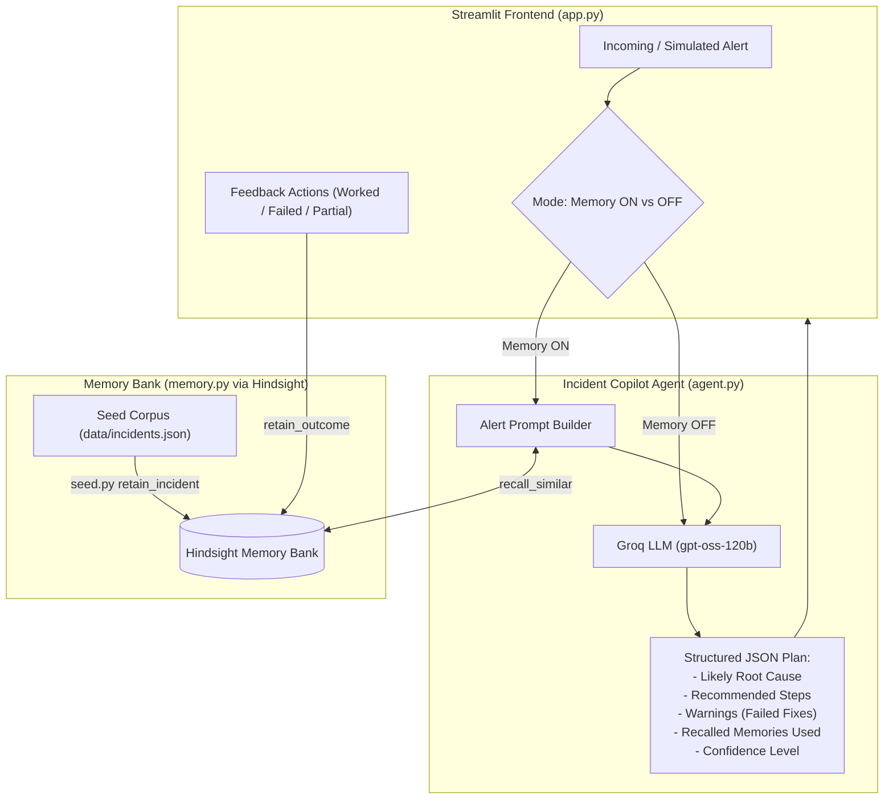

# 🚨 Incident Memory Agent

> **An AI-powered On-Call Incident Copilot that remembers what worked, warns against what failed, and continuously learns from engineer feedback — powered by Hindsight semantic memory and Groq LLM inference.**

[](https://www.python.org/downloads/)
[](https://streamlit.io/)
[](https://groq.com/)
[](https://hindsight.vectorize.io)
[](https://opensource.org/licenses/MIT)

---

## 📖 Overview

During high-severity production incidents, on-call engineers are under immense pressure to triage and resolve outages quickly. Traditional approaches suffer from two major flaws:

1. **Tribal Knowledge Loss:** Past incident postmortems are buried across Jira tickets, Google Docs, or Slack threads. Engineers often repeat mistakes by applying fixes that previously failed.
2. **Generic LLM Hallucinations:** Standard LLMs lack organizational context and provide textbook troubleshooting advice that ignores your specific service architecture and incident history.

**Incident Memory Agent** solves this by pairing **Groq's** high-speed inference with **Hindsight's** semantic memory layer. The agent recalls past incident resolutions, warns engineers if a proposed fix has failed before, provides actionable step-by-step remediation plans, and learns in real time from post-fix feedback.

---

## ✨ Key Features

- **🧠 Semantic Incident Memory (Hindsight):** Retains historical incidents (alerts, logs, root causes, remediation steps, and resolution outcomes) in a persistent memory bank.
- **⚡ Blazing-Fast LLM Inference (Groq):** Powered by `openai/gpt-oss-120b` via Groq for near-instant triage recommendations during critical outages.
- **⚖️ Side-by-Side Comparison:** Directly compare the baseline generic LLM suggestions ("Memory OFF") against memory-augmented recommendations ("Memory ON") to see the exact value of historical context.
- **⚠️ Negative Knowledge & Failure Warnings:** If a fix previously failed or only partially worked, the agent explicitly flags it so engineers don't waste MTTR repeating past mistakes.
- **🔄 Interactive Continuous Learning:** On-call engineers can teach the agent directly from the Streamlit UI (marking fixes as `✅ Worked`, `❌ Failed`, or `➖ Partial`), automatically committing feedback to Hindsight memory.
- **🛡️ Robust Error Handling:** Retry logic on LLM errors, graceful "no similar incidents found" messaging.

---

## 🏛️ System Architecture



---

## 🧠 How Hindsight Memory Is Used

Hindsight is the **semantic long-term memory backbone** of this agent. It is integrated at three distinct points in the system:

### 1. `retain_incident(incident)` — Storing Historical Knowledge

Called by `seed.py` once during setup (and can be called any time new incidents occur). Each incident is serialized into a structured natural-language string containing the service name, alert text, error logs, confirmed root cause, fix steps, outcome (worked/failed/partial), and time to resolve. This is stored in a Hindsight **memory bank** (`oncall-payments-team`) with the context tag `"incident"` and the incident ID as metadata.

```python
# memory.py
result = _call(
    "retain_batch",
    bank_id=BANK_ID,
    items=[{"content": content, "context": "incident", "metadata": {"incident_id": inc["id"]}}],
    retain_async=False,
)
```

### 2. `recall_similar(alert_text)` — Retrieving Relevant Memories at Triage Time

When a new alert fires, the agent calls `recall_similar` with the alert text as the query. Hindsight performs **multi-strategy retrieval (semantic, keyword, graph and temporal)** across the memory bank and returns the most relevant past incident chunks — not just keyword matches, but conceptually similar situations. These retrieved memories are injected into the LLM prompt as grounding context.

```python
# memory.py
results = _call(
    "recall",
    bank_id=BANK_ID,
    query=alert_text,
    max_tokens=1024,
    budget="mid",
)
```

This is the core of the **Memory ON vs. Memory OFF** toggle: without it, the LLM reasons from parametric knowledge only (generic advice); with it, the LLM reasons from your team's actual incident history.

### 3. `retain_outcome(incident_id, outcome)` — Continuous Learning from Feedback

After an engineer tries the recommended fix, they click one of the feedback buttons in the UI (`✅ Worked`, `❌ Failed`, `➖ Partial`). This stores a **feedback memory** in Hindsight with the outcome, confirmed root cause, and resolution time. Future `recall_similar` calls will surface this feedback, so the agent learns to warn against previously failed fixes.

```python
# memory.py
_call(
    "retain_batch",
    bank_id=BANK_ID,
    items=[{"content": content, "context": "outcome-feedback", "metadata": {...}}],
    retain_async=False,
)
```

### Why This Matters: The Demo Story

| Scenario | Memory OFF | Memory ON |
|:---|:---|:---|
| `search-service`: Redis connections maxed, 8s latency | Suggests: increase Redis pool size | Recalls INC-006: pool increase **failed**; INC-007: real cause was wildcard SCAN without TTL |
| Agent advice | Generic (increase `REDIS_POOL_SIZE`) | Specific: add TTL, replace SCAN, flush stale keys |
| Warnings | None | ⚠️ "Pool increase was tried in INC-006 and FAILED" |
| Confidence | Medium | **High** |

The **"Memories Used" panel** in the UI shows exactly which past incidents were recalled and cited. The **memory on/off toggle** makes the contrast viscerally obvious.

---

## 💡 The Showcase Scenario

Consider an alert for the `search-service`:

> **Alert:** `Search latency above 8s, Redis connections maxed out`

| Metric | ❌ Without Memory | ✅ With Hindsight Memory |
| :--- | :--- | :--- |
| **Root Cause** | Redis connection pool exhaustion (generic guess) | Wildcard `SCAN` on 600k keys without TTL — pool size is a red herring |
| **Fix** | Increase `REDIS_POOL_SIZE` and restart pods | Add 1h TTL, replace `SCAN` with keyed lookup, flush stale keys |
| **Warnings** | None | ⚠️ Increasing pool size was tried in INC-006 and **FAILED** |
| **Confidence** | Medium | **High** (backed by INC-006 & INC-007) |

---

## 📂 Project Structure

```text
incident-memory-agent/
├── data/
│   ├── demo_alerts.json     # Sample alerts for the UI dropdown
│   └── incidents.json       # 15 historical incident postmortems (seed corpus)
├── agent.py                 # Core reasoning agent (Groq + memory recall + retry logic)
├── app.py                   # Streamlit web app with feedback UI
├── memory.py                # Hindsight wrappers: retain_incident, recall_similar, retain_outcome
├── seed.py                  # CLI utility to seed all incidents into Hindsight
├── test_memory.py           # Quick verification: retain 2 incidents, recall, confirm
├── requirements.txt         # Python dependencies
├── .env.example             # Template for environment variables
└── README.md                # This file
```

---

## 🚀 Quickstart Guide

### 1. Prerequisites

- Python 3.10+
- A [Groq Cloud API Key](https://console.groq.com/) (free tier works)
- A [Hindsight Cloud](https://ui.hindsight.vectorize.io) account and API key

### 2. Clone & Set Up

```bash
git clone https://github.com/Pavankumar202/incident-memory-agent.git
cd incident-memory-agent

# macOS/Linux
python3 -m venv .venv
source .venv/bin/activate

# Windows
python -m venv .venv
.venv\Scripts\Activate.ps1
```

### 3. Install Dependencies

```bash
pip install -r requirements.txt
```

### 4. Configure Environment Variables

```bash
cp .env.example .env
```

Edit `.env`:

```dotenv
HINDSIGHT_API_KEY="your-hindsight-api-key"
HINDSIGHT_BASE_URL="https://api.hindsight.vectorize.io"
GROQ_API_KEY="your-groq-api-key"
BANK_ID="oncall-payments-team"   # optional, this is the default
```

### 5. Verify Memory Connection

```bash
python test_memory.py
```

Expected: a retained incident echoed back in the recall output.

### 6. Seed Historical Incidents

```bash
python seed.py
```

Expected output: `Seeded 15 incidents.`

### 7. Run CLI Before/After Comparison

```bash
python agent.py
```

Prints MEMORY OFF then MEMORY ON for the `search-service` alert, showing the contrast.

### 8. Launch the Streamlit UI

```bash
streamlit run app.py
```

Navigate to `http://localhost:8501`. From the dashboard:
1. Select an alert from the dropdown.
2. Choose **"Compare both"** and click **"Analyze alert"**.
3. See the side-by-side comparison with the **Memories Used** panel.
4. Click **✅ Worked / ❌ Failed / ➖ Partial** to teach the agent.

---

## ⚙️ Configuration Reference

| Variable | Required | Default | Description |
| :--- | :---: | :---: | :--- |
| `HINDSIGHT_API_KEY` | **Yes** | — | Authentication token for Hindsight |
| `HINDSIGHT_BASE_URL` | **Yes** | — | Hindsight API base URL |
| `GROQ_API_KEY` | **Yes** | — | Groq Cloud API key |
| `BANK_ID` | No | `oncall-payments-team` | Hindsight memory bank partition ID |

---

## 🧩 Output Schema

```json
{
  "likely_root_cause": "Wildcard Redis SCAN without TTL causing CPU saturation",
  "recommended_steps": [
    "Check slowlog to verify long-running SCAN queries",
    "Add 1h TTL to query cache keys",
    "Replace wildcard SCAN with keyed lookups",
    "Flush stale keys with redis-cli --scan"
  ],
  "memories_used": [
    "INC-006: search-service pool increase failed",
    "INC-007: search-service unindexed query scan fixed with TTL"
  ],
  "warnings": [
    "Do NOT simply increase REDIS_POOL_SIZE — tried in INC-006, FAILED."
  ],
  "confidence": "high",
  "no_history": false
}
```

---

## 🤝 Contributing

1. Fork the repository.
2. Create your feature branch: `git checkout -b feature/new-capability`
3. Commit your changes: `git commit -m 'Add new capability'`
4. Push and open a Pull Request.

---

## 📄 License

This project is licensed under the [MIT License](LICENSE).
